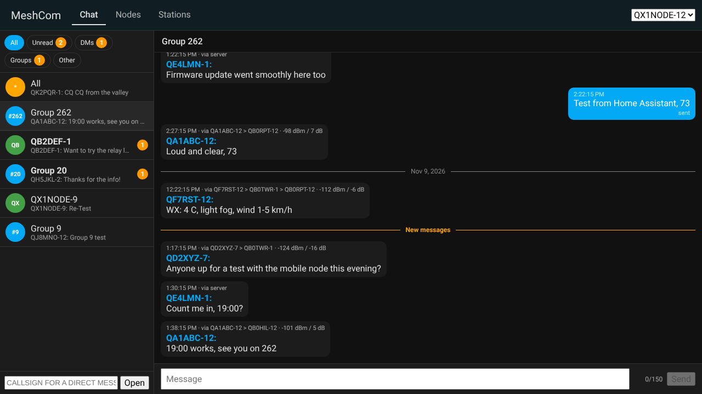
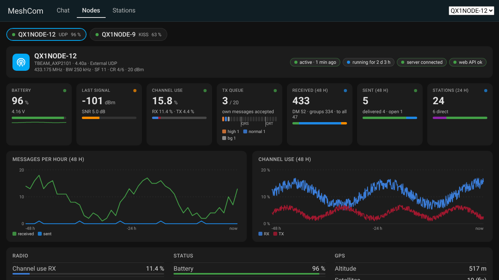
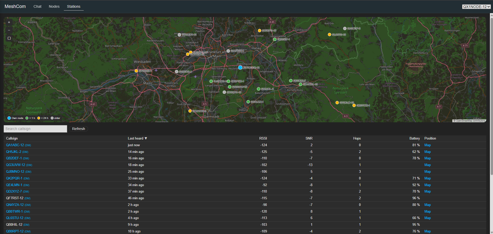
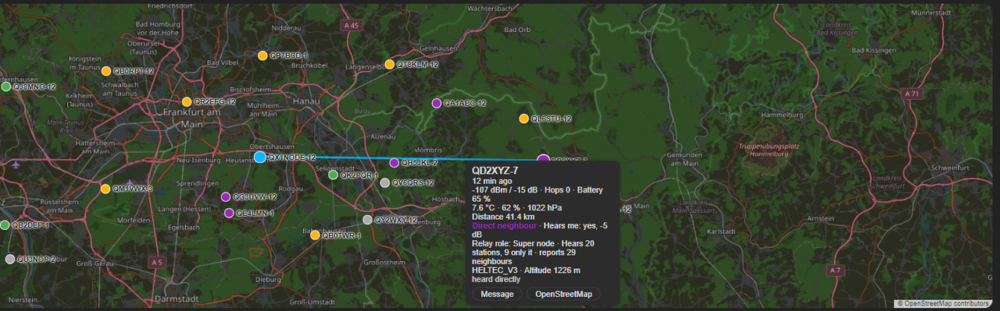
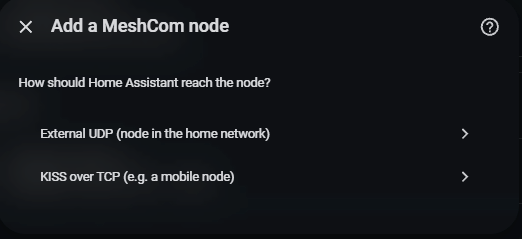
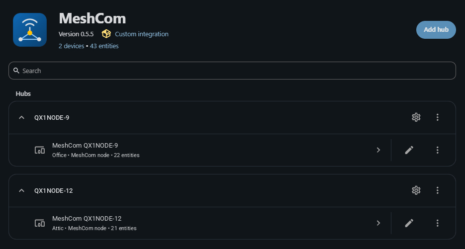
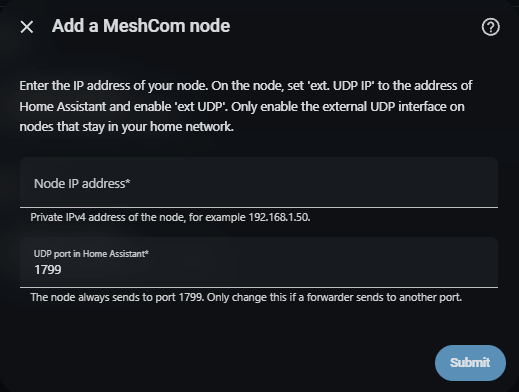
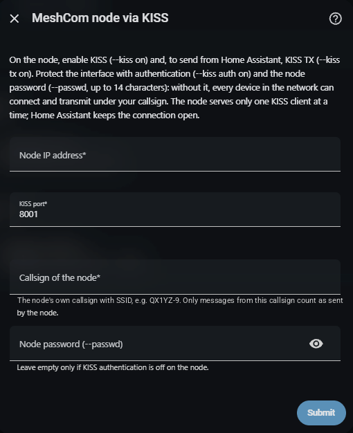
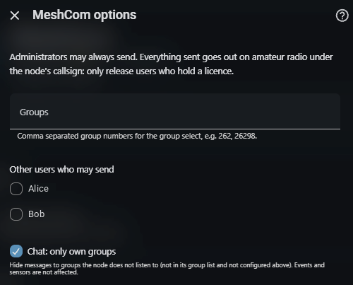
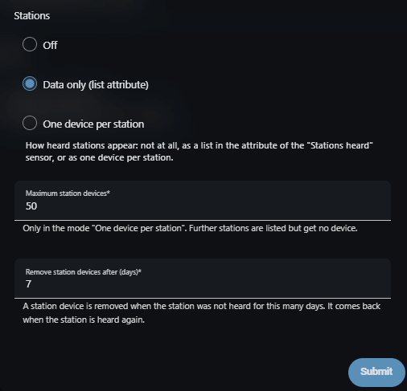

# MeshCom for Home Assistant

> [!WARNING]
> **For licensed radio amateurs only.** A MeshCom node is an amateur radio
> transmitter: it sends beacons, acknowledgements and your messages under
> its callsign. Operate it, and send from Home Assistant, only with a valid
> amateur radio licence and your own callsign, within the rules of your
> country. Only release Home Assistant users for sending who hold a licence
> themselves.

> **Status: beta.** Feedback and bug reports are welcome in the
> [issue tracker](https://github.com/netscout2001/meshcom-ha/issues).

A Home Assistant integration for the [MeshCom](https://icssw.org/en/meshcom/)
LoRa mesh network (433 MHz amateur radio). It shows your own MeshCom nodes and
the stations they hear, lets you read and send messages (broadcast, groups,
direct messages with delivery status) from the MeshCom panel (chat, nodes,
stations), dashboards and automations, and switches node settings such as
**No MSG All**.



## Contents

- [Screenshots](#screenshots)
- [Supported devices](#supported-devices)
- [Installation](#installation)
- [Configuration](#configuration)
- [What you get](#what-you-get)
- [Actions and events](#actions-and-events)
- [Data updates](#data-updates)
- [Examples](#examples)
- [Known limitations](#known-limitations)
- [Troubleshooting](#troubleshooting)
- [Removal](#removal)
- [Security](#security)
- [Development](#development)

## Screenshots

All screenshots use invented data: the callsigns start with `Q`, a prefix
that is not assigned to any country, so none of them belongs to a real
station.

| | |
| --- | --- |
|  |  |
| **Chat**: conversations for all, groups and direct messages; path and signal of every message, unread counters, "New messages" line | **Nodes**: dashboard per own node with status, tiles, 48-hour charts, sensor groups and direct neighbours |
|  |  |
| **Stations**: map of the own node and the heard stations (violet: direct neighbour, otherwise colour by last heard), sortable table below with "hears me", relay role and hardware | **Map**: a click on a station shows its values, distance and neighbour values, with buttons for a direct message and OpenStreetMap |
|  |  |
| **Setup**: choose external UDP or KISS over TCP | **Integration page**: one entry per node |
|  |  |
| **External UDP** setup | **KISS over TCP** setup |
|  |  |
| **Options**: groups, users who may send, own groups only | **Options**: how heard stations appear |

## Supported devices

- MeshCom nodes with firmware **4.40a** (tested). Firmware 4.34z to 4.40a
  have the same web API; older firmware has no web API (UDP still works).
- **External UDP** works on every node with the "ext UDP" function.
- **KISS over TCP** needs an ESP32-based node with firmware 4.40a.
- Several nodes at once, each as its own entry; UDP nodes share one port.

## Installation

### HACS (recommended)

[](https://my.home-assistant.io/redirect/hacs_repository/?owner=netscout2001&repository=meshcom-ha&category=integration)

1. In HACS search for **MeshCom**, open it and click **Download**.
2. Restart Home Assistant.

**Updates:** HACS checks for new releases on its own and shows them under
**Settings → Updates** (and in HACS). Click **Update**, then restart Home
Assistant. The release notes are shown before you update; they are the same
as in [CHANGELOG.md](CHANGELOG.md).

### Manual

Copy `custom_components/meshcom` from the latest release into the
`custom_components` folder of your configuration and restart Home Assistant.

The integration icon needs Home Assistant 2026.3 or newer; the integration
itself runs on 2025.6 or newer.

## Configuration

**Settings → Devices & services → Add integration → MeshCom.** First choose
how Home Assistant reaches the node.

### External UDP (node in the home network)

On the node set **ext. UDP IP** to the address of Home Assistant and enable
**ext UDP** (`--extudpip <ip>`, `--extudp on`).

| Field | Meaning |
| --- | --- |
| Node IP address | Private IPv4 address of the node |
| UDP port in Home Assistant | 1799; the node always sends to this port |

While Home Assistant waits, click **Send Position** on the node's web page.
The node is identified by the callsign in its own beacon.

A node is identified by its callsign for both access paths. If you move a
node from KISS to UDP or back (delete the entry and add it again with the
other access path), its device and entities come back with the same entity
ids and history.

### KISS over TCP (e.g. a mobile node)

On the node: `--kiss on`, for sending from Home Assistant `--kiss tx on`, for
RSSI/SNR `--kiss meta on`, and protect it with `--kiss auth on` and the node
password `--passwd`.

| Field | Meaning |
| --- | --- |
| Node IP address | Private IPv4 address of the node |
| KISS port | 8001 |
| Callsign of the node | The node's own callsign with SSID, e.g. `QX1YZ-9` |
| Node password | `--passwd` (1 to 14 characters); empty only if KISS authentication is off |

### Web password (both access paths)

Next, Home Assistant asks for the node's web password (`--webpwd`), used to
read and switch node settings and to read firmware, battery voltage and the
list of directly heard stations (MHeard).
Leave it empty if the node has none (not recommended, see
[Security](#security)). Both passwords can be changed later under
**Reconfigure**; if the node rejects one, Home Assistant asks for it
(reauthentication).

### Options

| Option | Meaning |
| --- | --- |
| Groups | Group numbers for the group select, in addition to the node's own groups |
| Other users who may send | Non-admin users released for sending and for the MeshCom panel |
| Chat: only own groups | On by default: messages to groups the node does not listen to stay out of the chat (events still fire) |
| Stations | Off / Data only (default) / Data only + devices for watched stations / One device per station |
| Watched stations (max. 10) | Only in the mode "Data only + devices for watched stations": the callsigns that get a device. Offers the stations the node knows, direct neighbours first and marked "(MHeard)"; a callsign can also be typed in |
| Maximum station devices | Default 50, only in the mode "One device per station" |
| Remove station devices after (days) | Default 7, only in the mode "One device per station" |
| Node inactive after (minutes) | Default 65: "Active" turns off when the node sent nothing for this long (the node beacons every 30 minutes by default) |
| Read radio statistics (LoRa queue) | Off by default: reads the node's RX log page (web API) for channel use and TX queue of the last 5 minutes and adds three sensors. The first request makes the node set aside memory for its RX log, which it keeps until it restarts |
| Neighbour lost after (hours) | Default 6: a direct neighbour counts as lost when the node has not received it directly for this long (fires "Direct neighbour lost", later "Direct neighbour back"). Needs the web password; 0 switches it off |

Changing the options reloads the node.

## What you get

### Entities of the own node

| Entity | Notes |
| --- | --- |
| Battery, Altitude | From the node's beacon; altitude disabled by default |
| Battery voltage | From the node's info page (web password needed if one is set); unknown on USB power |
| Last message, Last sender, Last message time | Messages to you, your groups and to all; kept over a restart |
| Messages received, Messages sent | Counters; continue over a restart |
| Stations heard (24 h) | In "data only" mode with the list attribute `stations` |
| Last RSSI (packet), Last SNR (packet) | Signal of the last packet the node received over the air: a message, position or telemetry of any station. Packets via the MeshCom server and the node's own frames carry none and keep the last value; kept over a restart; disabled by default |
| Firmware | From the node's beacon (UDP) or its info page (KISS) |
| Temperature, humidity, pressure, CO2 | Only if the node reports sensor values |
| Active (binary sensor) | On while the node sends packets; off after the time set in the options (default 65 minutes) |
| Last packet | Time of the last packet from the node; kept over a restart, so "Active" is right after a restart too |
| KISS connected (binary sensor) | KISS access only. Off within about 2 minutes when the node is switched off or out of reach; Home Assistant reconnects on its own |
| Position (device tracker) | Position of the node's beacon |
| Recipient type, Group, Station (selects), Message (text), Send, Clear (buttons) | Compose and send from a dashboard |
| Allow sending (switch) | Kill switch: off blocks every transmission through this node. Anyone may switch it off; only administrators switch it back on |
| No MSG All (switch) | The node's setting, read and written via the web API (administrators only). Not polled while the node is inactive |
| Message (notify) | Send with the standard action `notify.send_message`, to the recipient chosen in the recipient selects (all by default). A title is put in front of the text. Same checks as every send (kill switch, who may send, rate limit) |
| Firmware (update) | Firmware with the built-in update only (ESP32 boards; the node's `/austatus` page): installed and newest release as the node reports them, with a link to the release. **Install** (administrators only) lets the node download the release and then install it; the node restarts. Not offered over the unencrypted web login. Installing needs a board with Safeboot partition; while a phone is connected by Bluetooth the node may lack memory for the download |
| Channel use RX, Channel use TX, TX queue | Only with the option "Read radio statistics": share of the last 5 minutes the channel was busy receiving / sending, and frames waiting to be sent (attributes: size, per priority, waiting for acknowledgement, slow-down and refuse levels, state of own messages) |

**When a node is switched off**, Home Assistant notices it at different speeds:

- **KISS connected** goes off within about 2 minutes: the connection probes
  the idle node every 15 seconds after one minute of silence.
- **Web API** entities (No MSG All) become unavailable at the next query,
  at most 5 minutes later.
- **Active** goes off after the time set in the options (default 65
  minutes). With UDP there is no connection to watch; only the packets
  show that the node is there, and it beacons every 30 minutes.
- Measured values (battery, voltage, signal, ...) keep their last value,
  also over a restart; **Last packet** shows how old they are. A mobile
  node out of reach is not an error, and its history stays without gaps.

### Heard stations

| Mode | What you get |
| --- | --- |
| Off | Only the count and the station select for direct messages |
| Data only (default) | The attribute `stations` of "Stations heard": the 100 most recently heard stations with last heard, RSSI, SNR, hops, battery, position and `direct` (direct neighbour). Not written to the database. |
| Data only + devices for watched stations | Like "Data only" (the list attribute and the panel keep all stations), plus a device for each of up to **10 watched stations** chosen in the options. Watched stations keep their device however long they are silent; taking a station off the list removes its device. |
| One device per station | A device per station (behind the own node), for the first stations heard up to the set maximum. Removed after the configured days without a packet and back when heard again; can be deleted by hand. |

A station device has position, last heard, battery, hops, and:

| Entity | Meaning | Updated |
| --- | --- | --- |
| RSSI, SNR | How your node hears the station (its last packet) | with each packet |
| SNR at the station | How the station hears your node (its MHeard entry, "hears me") | every 5 minutes (web API) |
| Heard directly | On while the station is on your node's MHeard list | every 5 minutes, off 3 hours after it left the list |

plus temperature, humidity and air pressure for stations that send weather
values. RSSI, SNR and "SNR at the station" are recorded as long-term
statistics, so a statistics graph card shows them over time:

```yaml
type: statistics-graph
title: SNR of my neighbours
chart_type: line
period: hour
stat_types: [mean, min, max]
entities:
  - sensor.qx1yz_12_snr
  - sensor.qx1yz_12_snr_at_the_station
```

(The entity IDs depend on the callsign and the language at creation; look
them up on the station's device page.) Values from packets only change when
the station sends a packet: heartbeats are not passed on over UDP and KISS,
so a station heard only by heartbeat gets its SNR from the MHeard list once.

For every station the integration also keeps its weather values (temperature,
humidity, air pressure QNH and QFE, if the station sends them) and the relays
of its last packet; the panel shows both.

**Direct neighbours** come from the node's MHeard page (`/?page=mheard`),
read with the other web API values: the stations the node received directly
in the last 3 hours. This adds stations that only send heartbeats (UDP and
KISS do not pass those on) and, per station, hardware, altitude, "hears me"
(the SNR at which the station reports to hear your node), relay role (super
node, needed, redundant), how many stations it hears and how many of those
only it hears, the neighbour count it reports, and whether it is a gateway.
Where a packet already gave position, signal or firmware, those values are
kept (positions on the MHeard page have only three decimals). A station
stays a direct neighbour until it has been off the list for 3 hours. This
needs firmware 4.40a and the web password if the node has one.

The station list is stored and survives a restart.

### MeshCom panel

The sidebar entry **MeshCom** opens a panel with three tabs. With several
nodes, a selector at the top switches between them; the panel remembers the
selected node and tab per browser.

**Chat**: a conversation for messages to all, for every group and every
direct-message partner, plus read-only conversations for other addressees
(e.g. `TEST`). Filters: All, Unread, DMs, Groups (including the broadcast channel "All"), Other. Each message shows
time, path (`via QR1ABC-2 > QB0RLY-12`) and RSSI/SNR; a click on the path
shows it on the map. Conversations with new
messages show a badge with their number (read state is kept per browser);
when you open one, it starts at a "New messages" line, and a button jumps to
the newest message. Delivery of your direct messages is shown (sent,
delivered, rejected). The last 500 messages per node are stored.

**Nodes**: a dashboard of the selected node. With more than one node, a
row of chips at the top (status, callsign, access, battery) switches between
them; the choice is shared with the node selector and remembered.

- **Header**: callsign, hardware, firmware, access, radio settings
  (frequency, bandwidth, SF, CR, TX power) and status pills: active or
  inactive, running for (since the node's start), MeshCom server, KISS
  connection, web API.
- **Tiles** with a status dot and a bar: battery (with its course over
  48 hours), SNR of the last received packet (RSSI below it; for LoRa the
  SNR tells more about the link), channel use and TX queue (with the option "Read
  radio statistics"), messages received and sent in the last 48 hours (by
  kind and by delivery state), stations heard and direct neighbours.
- **Charts** of the last 48 hours: messages per hour (received, sent) and,
  with radio statistics, channel use RX/TX. The messages per hour are kept
  for 48 hours over a restart; battery and channel use come from the Home
  Assistant history (recorder).
- **Sensor groups**: radio (channel use, queue, dropped, duplicates, dedup
  window), status (battery, voltage, running for, last packet, WLAN signal,
  server, max. hops, blocked frames), GPS (altitude, satellites, next
  position, interval) and environment (only if the node reports sensors).
- **Direct neighbours** with SNR, "hears me", relay role, hardware and last
  heard; a click opens the station on the map.
- **Control**: "Allow sending" and "No MSG All", plus all entities of the
  node. The switches use the normal Home Assistant services, so only
  administrators can change them.

Hardware, radio settings, running time, WLAN signal, server state, hops and
blocked frames come from the node's info page, GPS state from its position
page (both web API). WLAN name, BSSID, IP addresses and the position from
these pages are not read.

**Stations**: a map with your node and every station that sent a position
(violet: direct neighbour, green: heard within the last hour, orange: within
24 hours, grey: older; a legend on the map explains the colours),
and below it the heard stations as a sortable table. "Direct neighbours
only" limits map and table to the stations your node hears directly (the
browser remembers the choice). The map moves with the mouse or one finger and zooms
with the mouse wheel, a double click or double tap, two fingers (pinch) or
the +/- buttons. A click on a station on
the map shows its values (signal, battery, weather), its distance from your
node (straight line, when both positions are known), for direct neighbours
"hears me", relay role and neighbour counts, hardware and altitude, and the
relays of its last packet, draws that path as a line to your node (dashed where a relay
has no known position) and has buttons for a direct message and for
OpenStreetMap. The table also lists temperature, humidity and air pressure
(QNH), "hears me", relay role and hardware; a violet dot marks direct
neighbours. In the table, a click on a callsign zooms the map to that
station (as does "Map"), and "(DM)" behind the callsign opens a direct
message.

The map tiles are loaded from OpenStreetMap (`tile.openstreetmap.org`) only
while the Stations tab is open, so the OpenStreetMap servers see your IP
address and the map area you look at. The panel itself loads no other code
from outside. With the station modes "One device per station" and "Data only + devices
for watched stations" those stations also appear on the Home Assistant map.

Administrators and the users released in the options may use the panel.

### No MSG All and the message filter

While **No MSG All** is on, Home Assistant shows what the node's display
shows: messages to your groups and direct messages to you. Messages to all,
to other groups and other addressees create no event, do not change the
"last message" sensors and do not appear in the chat; the senders still
count as heard stations.

### Who may send

- Administrators, and users released in the options. Automations may send.
- At most 3 messages in a row, then one every 30 seconds, for the whole
  Home Assistant instance.
- **Allow sending** off blocks everything for that node. Only administrators
  switch it back on.
- Only users who may send can change the draft (recipient, group, station,
  message text) in the dashboard entities.
- Every transmission appears in the logbook with the user or automation.

## Actions and events

### Action `meshcom.send_message`

| Field | Meaning |
| --- | --- |
| `config_entry_id` | The node to send through |
| `destination` | `*` (all), a group number (`262`) or a callsign (`QX1YZ-12`) |
| `message` | Text, at most 150 bytes, no line breaks or control characters |

Texts that look like protocol control traffic (`{CET}…`, `RM1 …`, endings
like `:ack12` or `{123`) are refused.

### Events

| Event | Fired for |
| --- | --- |
| `meshcom_message` | Every received or own text message (`sender`, `destination`, `destination_kind`, `text`, `to_me`, `is_own`, `via_server`, `path`, `rssi`, `snr`, `msg_id`) |
| `meshcom_message_sent` | A message sent from Home Assistant (with the context of the user or automation) |
| `meshcom_delivery_update` | Delivery status of your own messages (`msg_id`, `status`, `from`) |
| `meshcom_station_new` | A station heard for the first time (`callsign`, `heard`); at most 30 at once, then one every 2 minutes |
| `meshcom_neighbour_lost` | A direct neighbour not received directly for the time set in the options (`callsign`, `direct_heard`, `rssi`, `snr`) |
| `meshcom_neighbour_back` | A lost neighbour received directly again (same fields) |

All events carry `entry_id` and `node`.

### Device triggers

The node's device offers triggers for automations made in the UI (no YAML
needed): message received, direct message received, group message received,
own message delivered, own message not delivered (`failed` or `rejected`),
station heard for the first time, direct neighbour lost, direct neighbour
back. The event data is available as `trigger.event.data`.

Message text is untrusted data from the radio. Use it as data only; never
feed it into templates that are executed, commands or scripts.

## Data updates

- **UDP and KISS are push:** every packet updates the entities immediately.
- **Web API** (No MSG All, groups, firmware, battery voltage, MHeard list,
  info and position page, firmware update state, RX log page with the
  option): read every 5 minutes with one login, and right after a change
  from Home Assistant. While a firmware update runs, its state is read
  every 5 seconds (download) and every 10 seconds (restart).
- **Lost neighbours** are judged every minute, only while the MHeard list
  is at most 15 minutes old (a node that is away does not lose its
  neighbours).
- "Active" turns off when the node sent nothing for 65 minutes (beacons
  come every 30 minutes by default).

## Examples

### Blueprint: notification with reply

[](https://my.home-assistant.io/redirect/blueprint_import/?blueprint_url=https%3A%2F%2Fgithub.com%2Fnetscout2001%2Fmeshcom-ha%2Fblob%2Fmain%2Fblueprints%2Fautomation%2Fmeshcom%2Fnotify_with_reply.yaml)

[`notify_with_reply.yaml`](blueprints/automation/meshcom/notify_with_reply.yaml)
sends a push notification to a phone with the Home Assistant Companion app
for direct messages to the node and, optionally, for chosen groups and for
messages to all. The notification has a **Reply** button; the answer goes
back into the same conversation (to the sender, or into the group) with
`meshcom.send_message`.

The reply is sent by the automation under the node's callsign. Only choose a
phone whose owner holds an amateur radio licence.

### Node silent

Notify when the node has sent nothing for the time set in the options:

```yaml
automation:
  - alias: MeshCom node silent
    triggers:
      - trigger: state
        entity_id: binary_sensor.meshcom_qx1yz_12_active
        to: "off"
    actions:
      - action: notify.mobile_app_phone
        data:
          message: "MeshCom node QX1YZ-12 has been silent since {{ states('sensor.meshcom_qx1yz_12_last_packet') }}"
```

### Neighbour lost

With the device trigger (Settings → Automations → Create → Device →
the MeshCom node → "Direct neighbour lost"), or in YAML:

```yaml
automation:
  - alias: MeshCom neighbour lost
    triggers:
      - trigger: event
        event_type: meshcom_neighbour_lost
    actions:
      - action: notify.mobile_app_phone
        data:
          message: "{{ trigger.event.data.callsign }} not received directly since {{ trigger.event.data.direct_heard }}"
```

### Send with the notify action

```yaml
action: notify.send_message
target:
  entity_id: notify.meshcom_qx1yz_12_message
data:
  message: "Garage open"
```

The message goes to the recipient chosen in the node's recipient selects;
use `meshcom.send_message` to name the recipient in the automation.

### Your own automations

Notify on a direct message to you:

```yaml
automation:
  - alias: MeshCom direct message
    triggers:
      - trigger: event
        event_type: meshcom_message
        event_data:
          destination_kind: direct
          to_me: true
    actions:
      - action: notify.mobile_app_phone
        data:
          title: "MeshCom"
          # Sender first: Home Assistant would turn radio text such as
          # "[1, 2]" or "True" into a list or a boolean.
          message: "{{ trigger.event.data.sender }}: {{ trigger.event.data.text }}"
```

Send a daily message to a group:

```yaml
automation:
  - alias: MeshCom good morning
    triggers:
      - trigger: time
        at: "07:30:00"
    actions:
      - action: meshcom.send_message
        data:
          config_entry_id: YOUR_ENTRY_ID
          destination: "262"
          message: "Guten Morgen aus dem Shack"
```

Use cases: a chat on the wall tablet, notifications for direct messages,
weather of the stations around you,
presence of a mobile node ("Active"), a map of heard stations, switching
**No MSG All** at night.

## Known limitations

- **KISS:** frames carry no MeshCom message id and no firmware version, so
  the "Firmware" sensor stays empty and the node id is derived from the
  callsign. The node serves one KISS client at a time; Home Assistant keeps
  that slot. RSSI/SNR are those of the last hop and need `--kiss meta on`.
- **Firmware 4.34z–4.40a web login** is plain text (see [Security](#security)).
- **Battery voltage, firmware (KISS), direct neighbours and the dashboard
  values of the info, position and RX log pages** are read from the node's
  HTML pages with fixed patterns. A firmware that changes these
  pages makes the values disappear (the rest keeps working) until the
  integration is adapted.
- Direct messages between other stations are passed on as events but not
  counted and not shown in the chat.
- A temperature of exactly 0.0 °C is reported as unknown (the node sends 0
  for "no value").
- **Firmware update:** only firmware with the built-in update offers it
  (ESP32; not nRF52 boards such as RAK or T-Echo). Home Assistant shows what
  the node found; it does not look for releases itself.
- HACS installs releases, not the newest commit.

## Troubleshooting

| Problem | What to check |
| --- | --- |
| "No packet from the node" during setup | ext UDP on, ext. UDP IP = Home Assistant, then "Send Position" |
| "The node's web interface cannot be reached" | IP address; firmware 4.34z or newer |
| Warning "uses the unencrypted web login" | Expected with firmware up to 4.40a; disappears after an update with the secure login |
| "KISS interface cannot be reached" | `--kiss on`, port 8001, no other KISS client connected |
| Warning "KISS interface without authentication" | Set `--passwd` and `--kiss auth on`, then Reconfigure |
| Sending fails with "does not allow sending via KISS" | `--kiss tx on` |
| MeshCom panel is empty | User is neither administrator nor released in the options |
| No icon | Home Assistant 2026.3 or newer needed |

Debug logging:

```yaml
logger:
  logs:
    custom_components.meshcom: debug
```

Diagnostics (device page → Download diagnostics) contain no addresses,
callsigns, positions, message text or passwords and can be attached to an
issue.

## Removal

1. **Settings → Devices & services → MeshCom → ⋮ → Delete** for each node.
   The stored station list and chat history are deleted with it.
2. Uninstall in HACS (or delete `custom_components/meshcom`) and restart.
3. On the node, switch off what you enabled for Home Assistant: ext UDP
   (`--extudp off`) or KISS (`--kiss off`).

## Security

Everything received from the mesh is treated as untrusted data. Transmitting
is restricted to administrators by default. See [SECURITY.md](SECURITY.md)
for the security policy and how to report a vulnerability.

Recommended node settings:

- Set a **web password** on every node (`--webpwd`, up to 19 characters).
  Without it, every device and every browser on your network can read the
  node's WLAN password.
- Firmware 4.34z to 4.40a send the web password unencrypted and then trust
  the client's IP address for 4 hours. Home Assistant logs out right after
  every query and switches to the secure nonce/HMAC login as soon as the
  node offers it, never back. While the node is inactive (not heard for the
  time set in the options), Home Assistant does not log in at all: its
  address may meanwhile belong to another device.
- Only enable **ext UDP** on nodes that stay in your home network; the
  interface accepts commands from any device on that network.
- For **KISS**, always use `--kiss auth on` with `--passwd`.

Remaining risks you should know:

- **External UDP is not authenticated.** Home Assistant only accepts
  datagrams from the node's address and limits their rate, but a device in
  your network can forge that sender address and inject fake messages,
  positions or delivery confirmations. Keep untrusted devices out of the
  node's network (e.g. a separate VLAN for guests and IoT) or use KISS with
  authentication.
- **Automations send without the per-user check.** The users released in the
  options apply to the panel, the dashboard entities and actions started by a
  user. An automation (also the notify-with-reply blueprint) sends under the
  node's callsign on its own; only give such automations to licensed people.
- **A forged flood starves the real node.** The rate limit per sender
  address protects Home Assistant, but forged datagrams with the node's
  address use up the same budget, so real packets are dropped for as long
  as the flood lasts.
- **"Delivered" is not proof.** The acknowledgement of a direct message is
  an ordinary radio packet; any station that heard the message can send a
  matching one.
- **KISS: your callsign via the MeshCom server.** Frames with your own
  callsign that came over the air carry signal values and are recognised as
  foreign. Frames relayed from the MeshCom server (internet) carry the same
  "no measurement" marker as the node's own, so someone forging your
  callsign there can make a message or position look like your node's own.
  This is a limit of the firmware's KISS metadata.
- **The web password protects the node, not against your network.** On
  firmware 4.40a it travels in plain text (see above). The secure login
  shows a node impersonator a nonce and an HMAC of it, which allows an
  offline guessing attack on weak passwords - use a long random one.
- **Every Home Assistant user can read the entities.** Last message,
  stations and positions are normal entity states; Home Assistant has no
  per-entity read permission. The MeshCom panel and its history are limited
  to administrators and released users.
- **The Stations map loads tiles from OpenStreetMap** while the tab is open
  (see [MeshCom panel](#meshcom-panel)).

## Development

| Path | Content |
| --- | --- |
| `custom_components/meshcom/` | The Home Assistant integration |
| `custom_components/meshcom/aiomeshcom/` | Protocol library (asyncio, no Home Assistant dependency) |
| `custom_components/meshcom/frontend/` | MeshCom panel: chat, nodes, stations (plain web component) |
| `tests/lib/` | Library tests, including anonymised real-world packets |
| `tests/integration/` | Home Assistant integration tests |
| `tools/` | Capture anonymiser, brand icon source |
| `blueprints/` | Automation blueprints (notification with reply) |
| `tools/screenshots/` | Demo data and script for the panel screenshots in `docs/images/` (invented data only) |
| `docs/images/` | Screenshots used in this README |

```bash
python -m venv .venv && . .venv/bin/activate
pip install -e ".[test]"
pytest                      # library tests
ruff check . && ruff format --check .
mypy                        # library types

# Home Assistant integration tests (separate environment)
pip install "pytest-homeassistant-custom-component==0.13.316" pytest-cov
pytest tests/integration -o addopts="" -o asyncio_mode=auto \
  --cov --cov-config=tests/integration/.coveragerc
mypy --config-file tests/integration/mypy.ini custom_components/meshcom tests/integration
```

A new version in `manifest.json` together with a section in `CHANGELOG.md`
creates the release when it reaches `main`.

## License

[MIT](LICENSE)

MeshCom is a project of [ICSSW](https://icssw.org). This integration is an
independent community project and not affiliated with ICSSW.
